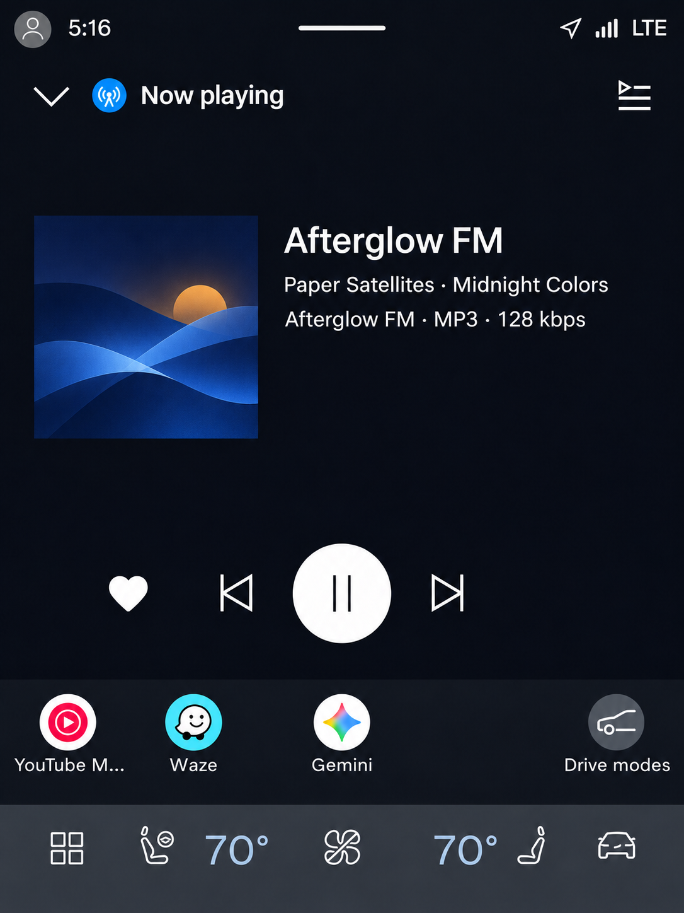
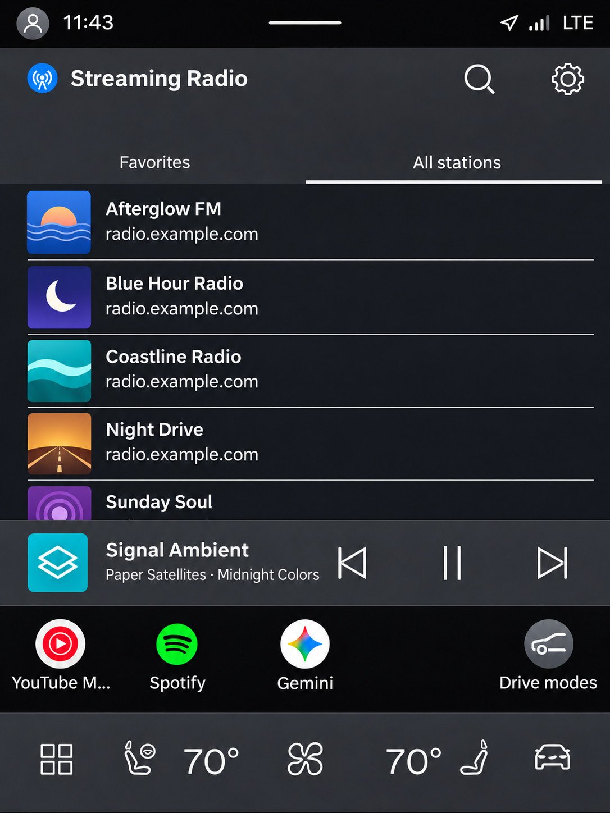
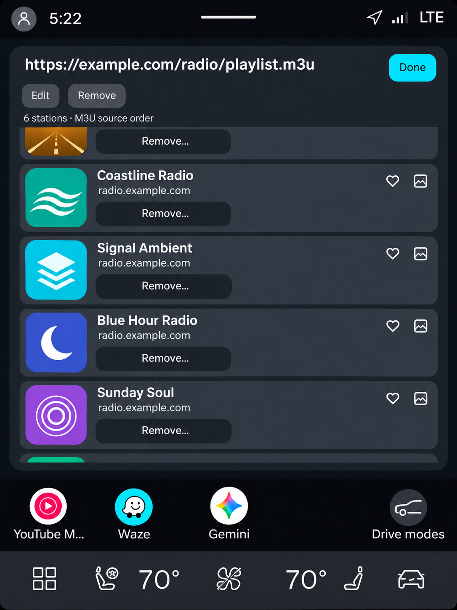
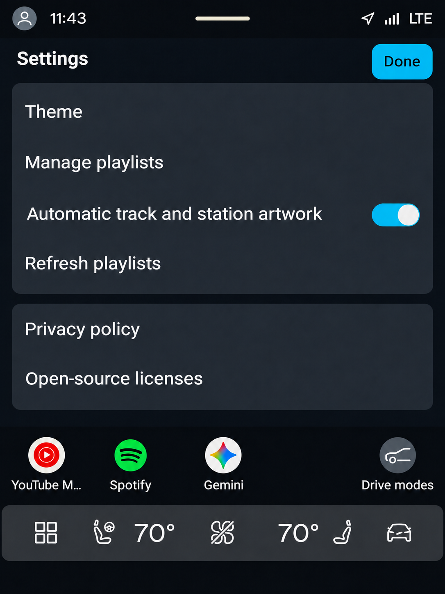
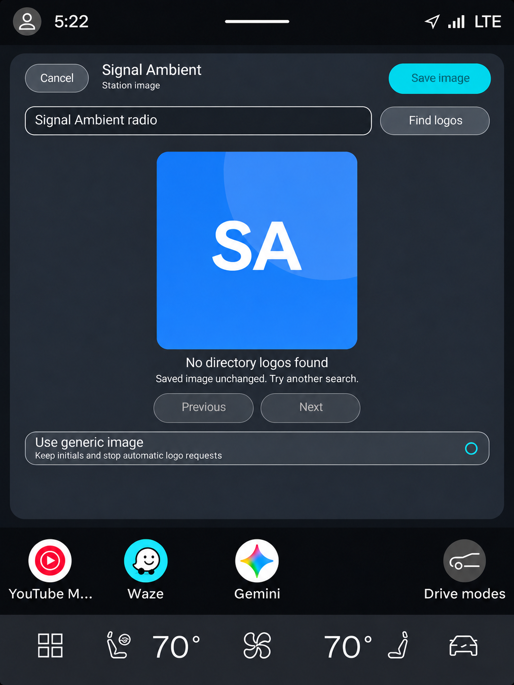

*Modified for Streaming Radio by Impostor Labs.*

# Streaming Radio

**Your stations. Your playlists. Built for Android Automotive OS.**

Streaming Radio by **Impostor Labs** brings hosted M3U playlists, favorites, and available track information to cars with Google built-in. It runs natively on Android Automotive OS; it does not require phone-to-car Bluetooth playback.

[Getting started](#getting-started) · [Build](BUILD.md) · [Privacy](docs/privacy.html) · [License](LICENSE)

## What it does

- **Bring your own playlist:** add hosted M3U URLs, preserve source order, refresh stations, and retain the last good copy if a refresh fails.
- **Make it yours:** combine playlists, reorder stations and favorites, hide unwanted stations, and shuffle station navigation through the native player's available actions.
- **See what's playing:** station names stay distinct from artist/title metadata; bitrate and codec appear when available. Some streams do not send track metadata.
- **Keep playback close:** the car's native media host provides playback controls and browsing. Playlist management and other app-owned configuration screens are parked-only.
- **Choose the look:** blue by default, with a range of accent themes and optional artwork lookup. Online artwork is enabled by default unless turned off in Settings.

No station catalog is bundled. Screenshots and personal test libraries do not imply broadcaster affiliation or redistribution permission.

## A look inside

These are screenshot-style reconstructions based on the app's photographed Volvo Android 13 layouts, not captured screenshots. Fictional stations, original sample artwork, example.com URLs and anonymous profile icons keep personal test data out of the gallery.

<p>
  
  
</p>
<p>
  
  
</p>
<p>
  
</p>
**VR01-F:** Player · **VR02-F:** Stations · **VR03-F:** Playlist management · **VR04-F:** Settings · **VR05-F:** Image picker. These approved illustrations show the existing UI structure; they are not pixel-exact verification of any vehicle or release. No sample stations or artwork are bundled.

See [gallery provenance](docs/SCREENSHOTS.md).

## Getting started

New to M3U files? See the [playlist guide](docs/PLAYLIST-GUIDE.md) and its downloadable template.

1. Install Streaming Radio from the Android Automotive OS internal testing track on the car. Use the existing installation's **Update** option to retain saved playlists and favorites.
2. While parked, open **Settings → Manage playlists → Add playlist** and enter a direct HTTPS URL to an M3U file. It should return playlist text, not a web page requiring sign-in.
3. Select a station, add favorites, and customize the theme if desired.

Keep passwords and private tokens out of public playlist URLs. This app plays streams from their original hosts; access, regional availability, and content rights remain subject to those hosts and rights holders.

## Build

Use **JDK 17**, **Android SDK Platform 36**, and the included Gradle wrapper. Minimum Android API is 28; target API is 36.

```bash
# Local automotive debug APK
./gradlew :app:assembleAutomotiveDebug

# Unsigned release AAB unless upload signing is configured
./gradlew :app:bundleAutomotiveRelease

# Release unit tests and lint
./gradlew :app:testAutomotiveReleaseUnitTest :app:lintAutomotiveRelease
```

On Windows use `gradlew.bat`. Gradle uses the available processor count by default; `--max-workers=N` can limit it. Existing Windows rebuild helpers now set their worker limit to the available logical processor count. Parallel tasks do not guarantee 100% CPU utilization.

See [BUILD.md](BUILD.md) for toolchain and signing details. Never commit upload keys, passwords, `local.properties`, or personal playlists.

## Verify before pushing

```bash
# Prerequisites, source-tree parity, and tooling regressions only
node tools/verify-automotive.cjs --preflight

# Same full verification command used by GitHub Actions
node tools/verify-automotive.cjs
```

Run this from a fresh checkout of the exact candidate commit. The full command checks Java/SDK prerequisites, source parity and tooling regressions, then runs debug and release unit tests for automotive and phone, release lint, an unsigned bundle, runtime dependency inventory and OSV. It never starts an emulator or installs an app. Signing variables are removed from child processes. A quick debug build is not this full verification.

Evidence is saved at `app/build/reports/verification/verification.json`, including the commit and clean/dirty working-tree status. A dirty working-tree pass is candidate evidence, not proof of the committed tree. See [verification guide](docs/VERIFICATION.md).

## Testing and release status

This source contains the AAOS **v14** recovery candidate for package `com.impostorlabs.streamingradio`. Check the version offered by the car's Play Store before testing. The driving media host controls native browsing and playback.

Phone and AAOS builds use dedicated internal testing tracks. Firebase playlist transfer remains disabled.

GitHub Actions builds unsigned candidates, runs unit tests and lint, and checks the resolved dependency inventory against OSV. Dependabot proposes dependency updates; updates and releases still need review. No automatic Play deployment or automatic merging is configured.

## Privacy and artwork

No app account, analytics SDK, or advertising SDK is included. Playlists, favorites, settings, and cached artwork are stored locally. Playback contacts your stream hosts; optional artwork lookup sends station or track queries to external providers. Some user-selected streams use unencrypted HTTP. See the [privacy policy](docs/privacy.html).

Apple/iTunes artwork requests are disabled in release builds. Artwork availability is not a blanket license to reuse every image. Station and image rights are separate from the source-code license.

## Open source

A modified fork of [Twinsen Radio](https://github.com/szczepl/twinsen-radio), originally copyright © 2026 Leszek Szczepanowski. See [Licensing](LICENSING.md) for the Apache 2.0 and GPL options and the scope of the upstream permission.

Based on Twinsen Radio by Leszek Szczepanowski. See [NOTICE](NOTICE) for attribution.

See [LICENSE](LICENSE), [third-party notices](THIRD-PARTY-NOTICES.md), and the preserved [upstream README](UPSTREAM-README.md). Not affiliated with or endorsed by Volvo, Google, or any broadcaster.

For contributors and future agents: [build notes](BUILD.md), [security status](SECURITY.md), [changelog](CHANGELOG.md), [design rules](docs/DESIGN-SYSTEM.md), and [current handoff](docs/HANDOFF-NEXT.md).
