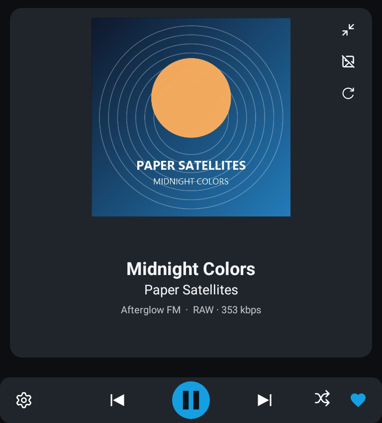
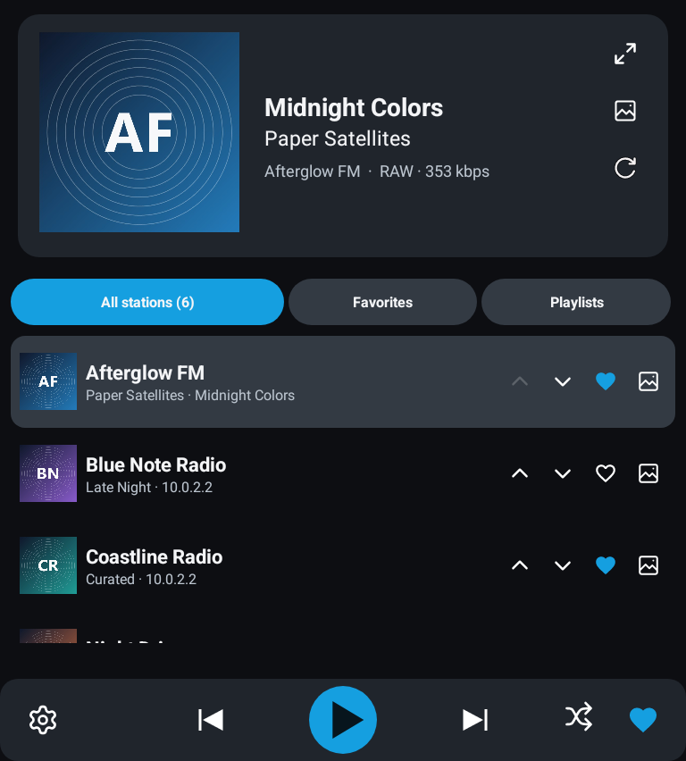
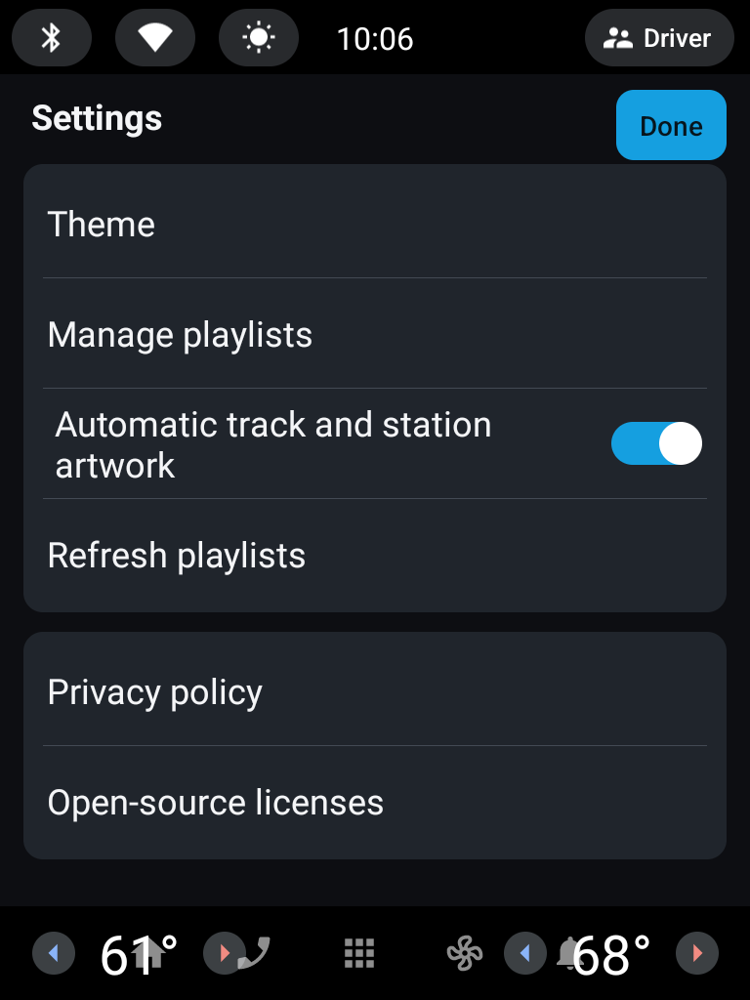
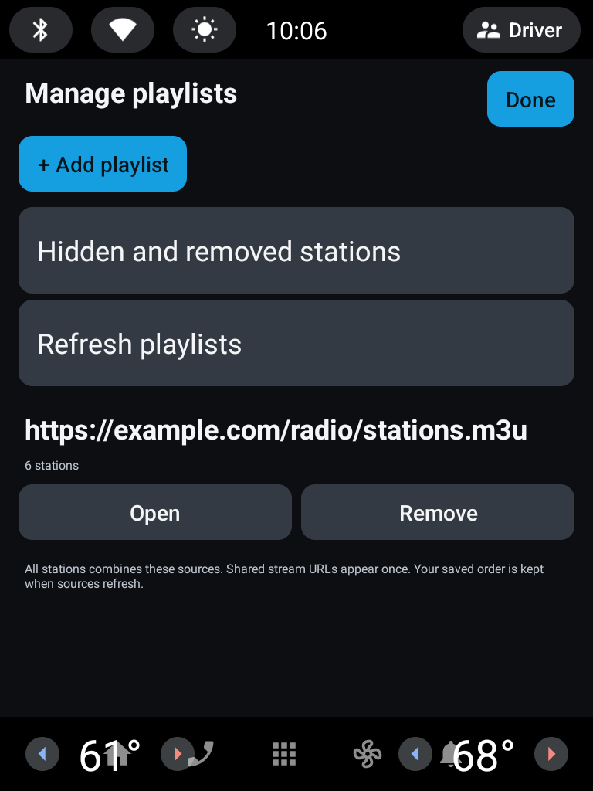

# Streaming Radio

**Your stations. Your playlists. Built for Android Automotive OS.**

Streaming Radio by **Impostor Labs** brings hosted M3U playlists, favorites, and available track information to cars with Google built-in. It runs natively on Android Automotive OS; it does not require phone-to-car Bluetooth playback.

[Getting started](#getting-started) · [Build](BUILD.md) · [Privacy](docs/privacy.html) · [License](LICENSE)

## What it does

- **Bring your own playlist:** add hosted M3U URLs, preserve source order, refresh stations, and retain the last good copy if a refresh fails.
- **Make it yours:** combine playlists, reorder stations and favorites, hide unwanted stations, and shuffle station navigation through the native player's available actions.
- **See what's playing:** station names stay distinct from artist/title metadata; bitrate and codec appear when available. Some streams do not send track metadata.
- **Keep playback close:** the car's native media host provides playback controls and browsing. Playlist management and other app-owned configuration screens are parked-only.
- **Choose the look:** blue by default, with a range of accent themes and optional artwork lookup. Online artwork is enabled by default unless turned off in Settings.

No station catalog is bundled. Screenshots and personal test libraries do not imply broadcaster affiliation or redistribution permission.

## A look inside

<p>
  
  
</p>
<p>
  
  
</p>

**Emulator captures, not Volvo photographs.** The pictured custom player is a debug-only prototype excluded from retail release builds; Volvo controls the retail native media-player layout. These captures do not promise that layout or controls on a production vehicle. The player and station-list images are app-content-only prototype captures with the bottom dock excluded. The Settings and Manage playlists images are raw 768 x 1024 captures from an Android 13 / API33 emulator, including its system bars; they use shared large heading, row and action sizes. Long playlist URLs stay unboxed and use a middle ellipsis when needed, with Open and Remove actions below. Playlist management is for parked use. Emulator system bars and available app area vary from vehicle hosts. No Volvo system interface has been simulated or composited into the images.

The six demo stations, icons, artist **Paper Satellites**, track **Midnight Colors**, album art and quiet synthetic audio are screenshot fixtures, not a bundled radio catalog or commercial recording. Online artwork is enabled for this demo and by default in release builds unless turned off in Settings. The [Favorites capture](docs/images/favorites.png) also shows the up/down ordering controls. A disabled up arrow on the first row prevents moving past the beginning of the list.

## Getting started

New to M3U files? See the [playlist guide](docs/PLAYLIST-GUIDE.md) and its downloadable template.

1. Install through an available Android Automotive OS testing track. There is no public production release yet.
2. While parked, open **Settings → Manage playlists → Add playlist** and enter a direct HTTPS URL to an M3U file. It should return playlist text, not a web page requiring sign-in.
3. Select a station, add favorites, and customize the theme if desired.

Keep passwords and private tokens out of public playlist URLs. This app plays streams from their original hosts; access, regional availability, and content rights remain subject to those hosts and rights holders.

## Build

Use **JDK 17**, **Android SDK Platform 36**, and the included Gradle wrapper. Minimum Android API is 28; target API is 36.

```bash
# Local automotive debug APK
./gradlew :app:assembleAutomotiveDebug

# Unsigned release AAB unless upload signing is configured
./gradlew :app:bundleAutomotiveRelease

# Release unit tests and lint
./gradlew :app:testAutomotiveReleaseUnitTest :app:lintAutomotiveRelease
```

On Windows use `gradlew.bat`. Gradle uses the available processor count by default; `--max-workers=N` can limit it. Existing Windows rebuild helpers now set their worker limit to the available logical processor count. Parallel tasks do not guarantee 100% CPU utilization.

See [BUILD.md](BUILD.md) for toolchain and signing details. Never commit upload keys, passwords, `local.properties`, or personal playlists.

## Verify before pushing

```bash
# Prerequisites, source-tree parity, and tooling regressions only
node tools/verify-automotive.cjs --preflight

# Same full verification command used by GitHub Actions
node tools/verify-automotive.cjs
```

Run this from a fresh checkout of the exact candidate commit. The full command checks Java/SDK prerequisites, source parity and tooling regressions, then runs debug and release unit tests for automotive and phone, release lint, an unsigned bundle, runtime dependency inventory and OSV. It never starts an emulator or installs an app. Signing variables are removed from child processes. A quick debug build is not this full verification.

Evidence is saved at `app/build/reports/verification/verification.json`, including the commit and clean/dirty working-tree status. A dirty working-tree pass is candidate evidence, not proof of the committed tree. See [verification guide](docs/VERIFICATION.md).

## Testing and release status

Current source candidate: **0.3.0-rc7**, version code **9**, package `com.impostorlabs.streamingradio`. Native media favorite actions now advertise hearts; playlist naming and management use the approved UX. Artwork lookup checks bounded matching releases, distinguishes unavailable services from missing covers, and respects retry delays. Android 13 / API 33 is the development vehicle OS level. System-wide audio distortion was reported during real-car testing and remains under investigation; this candidate does not claim to fix it. Public-release acceptance remains blocked. Passing tests is not vehicle certification or Play approval.

GitHub Actions builds unsigned candidates, runs unit tests and lint, and checks the resolved dependency inventory against OSV. Dependabot proposes dependency updates; updates and releases still need review. No automatic Play deployment or automatic merging is configured.

## Privacy and artwork

No app account, analytics SDK, or advertising SDK is included. Playlists, favorites, settings, and cached artwork are stored locally. Playback contacts your stream hosts; optional artwork lookup sends station or track queries to external providers. Some user-selected streams use unencrypted HTTP. See the [privacy policy](docs/privacy.html).

Apple/iTunes artwork requests are disabled in release builds. Artwork availability is not a blanket license to reuse every image. Station and image rights are separate from the source-code license.

## Open source

A modified **GPL-3.0-or-later** fork of [szczepl/twinsen-radio](https://github.com/szczepl/twinsen-radio), originally copyright © 2026 Leszek Szczepanowski. Impostor Labs contributors made the AAOS, playlist, player, artwork, and release-preparation changes. Original authors retain their copyrights.

See [LICENSE](LICENSE), [third-party notices](THIRD-PARTY-NOTICES.md), and the preserved [upstream README](UPSTREAM-README.md). Not affiliated with or endorsed by Volvo, Google, or any broadcaster.

For contributors and future agents: [build notes](BUILD.md), [security status](SECURITY.md), [changelog](CHANGELOG.md), [design rules](docs/DESIGN-SYSTEM.md), and [current handoff](docs/HANDOFF-NEXT.md).
